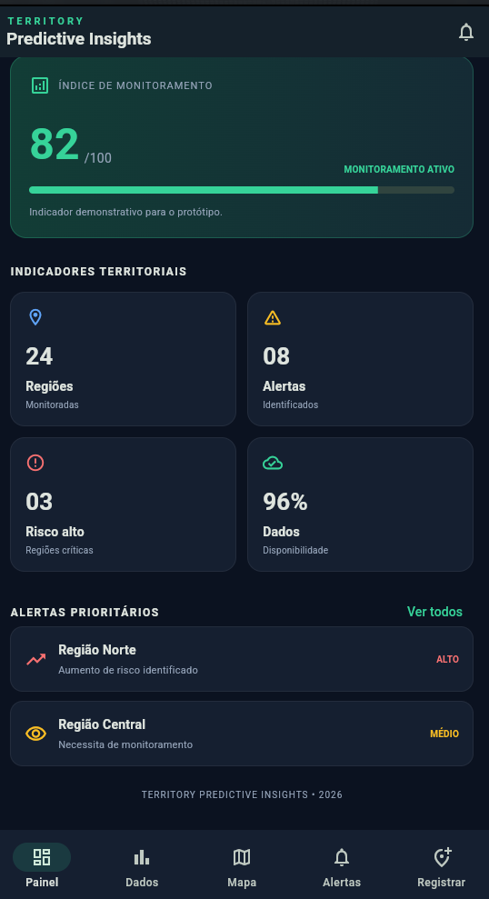
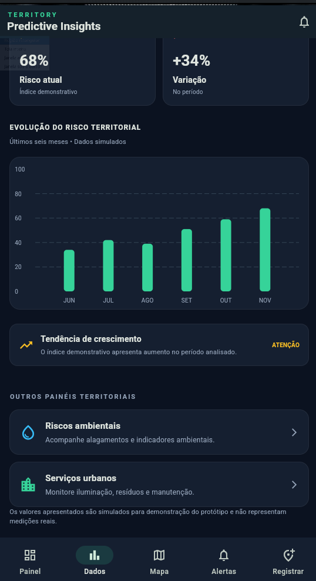
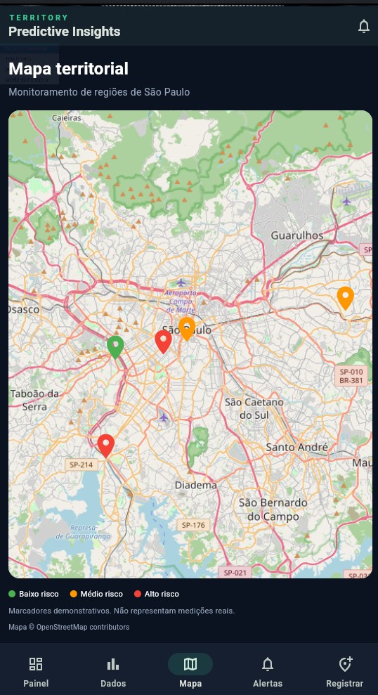
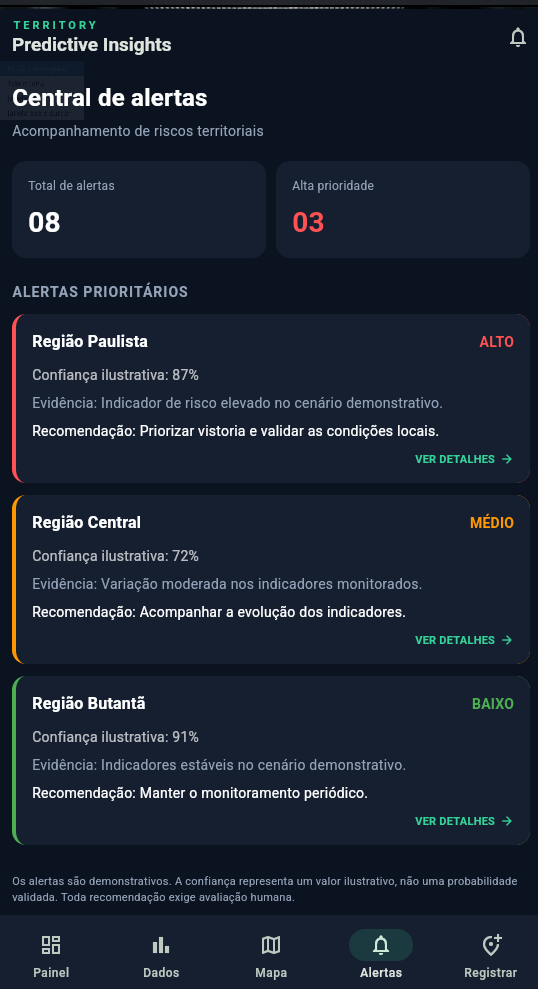
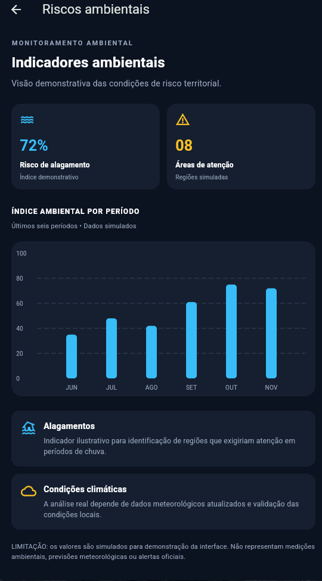
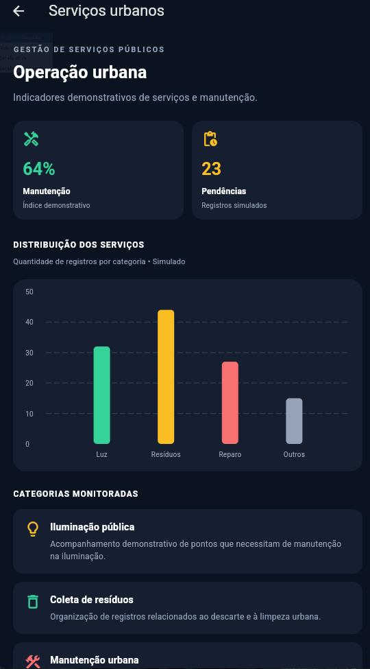

# TERRITORY PREDICTIVE INSIGHTS

**Plataforma de inteligência territorial para monitoramento de problemas urbanos e apoio à tomada de decisão.**

Projeto desenvolvido para a Global Solution 2026.2 — FIAP.

---

## Integrantes

| Nome | RM |
|---|---|
| João Vitor Lima Caldeira | 566541 |
| Miguel Vanucci Delgado | 563491 |

## Sobre o projeto

O Territory Predictive Insights é uma aplicação desenvolvida para apoiar o monitoramento territorial, a identificação de problemas urbanos e a organização de informações relevantes para a gestão das cidades.

A solução reúne indicadores, dashboards, visualização geográfica, alertas operacionais e registro de ocorrências em uma única aplicação.

A proposta busca contribuir para uma gestão urbana mais organizada, apoiando a identificação de situações que necessitam de atenção e a priorização de ações.

## Objetivo

Desenvolver uma solução digital que facilite o acompanhamento de condições territoriais, permitindo visualizar informações por meio de indicadores, gráficos, mapas e alertas.

O projeto está relacionado ao **ODS 11 — Cidades e Comunidades Sustentáveis**, contribuindo para a discussão sobre cidades mais inclusivas, seguras, resilientes e sustentáveis.

## Funcionalidades

- **Painel operacional:** visão geral dos indicadores e alertas prioritários.
- **Dashboard de dados:** apresentação de indicadores territoriais e gráficos.
- **Dashboard ambiental:** visualização de indicadores relacionados ao contexto ambiental.
- **Dashboard de serviços urbanos:** acompanhamento demonstrativo de indicadores de serviços urbanos.
- **Mapa territorial:** visualização de pontos em diferentes regiões de São Paulo.
- **Alertas prioritários:** apresentação de situações classificadas por nível de prioridade.
- **Detalhamento de alertas:** evidências, nível de confiança e recomendações.
- **Validação humana:** permite registrar a análise do responsável sobre um alerta.
- **Registro de ocorrências:** formulário para informar problemas urbanos.
- **Persistência local:** armazenamento de ocorrências e validações no dispositivo.

## Tecnologias utilizadas

- Flutter
- Dart
- Material Design 3
- fl_chart
- flutter_map
- latlong2
- shared_preferences
- OpenStreetMap

## Estrutura do projeto

```text
lib/
├── main.dart
├── occurrence_page.dart
├── occurrence_store.dart
├── environmental_dashboard_page.dart
└── urban_services_dashboard_page.dart

assets/
└── screenshots/
```

### Organização dos componentes

- `main.dart`: estrutura principal, navegação, painel, dashboards de dados, mapa e alertas.
- `occurrence_page.dart`: formulário de registro de ocorrências.
- `occurrence_store.dart`: gerenciamento compartilhado da quantidade de ocorrências.
- `environmental_dashboard_page.dart`: dashboard ambiental.
- `urban_services_dashboard_page.dart`: dashboard de serviços urbanos.

## Evidências da aplicação

### 1. Painel operacional

Visão geral dos indicadores e ocorrências registradas.



### 2. Dashboard de dados

Indicadores e gráficos para análise territorial.



### 3. Mapa territorial

Visualização geográfica de pontos de interesse em São Paulo.



### 4. Alertas prioritários

Lista de alertas organizados por prioridade.



### 5. Registro de ocorrências

Formulário com seleção do tipo de problema, região, descrição e consentimento.


### 6. Dashboard ambiental

Indicadores e visualizações demonstrativas do contexto ambiental.



### 7. Dashboard de serviços urbanos

Indicadores e gráficos relacionados aos serviços urbanos.



### 8. Detalhamento e validação humana

Apresentação de evidências, confiança, recomendações e análise humana do alerta.


### 9. Alerta após validação

Demonstração do registro da validação humana.


## Persistência e funcionamento

A aplicação utiliza armazenamento local por meio do pacote `shared_preferences`.

As ocorrências registradas e o estado de validação humana dos alertas são mantidos no dispositivo, permitindo recuperar essas informações após fechar e abrir novamente o aplicativo.

A contagem de ocorrências é compartilhada entre as telas da aplicação.

## Dados e limitações

Os indicadores, gráficos, alertas e níveis de confiança apresentados nesta versão possuem caráter demonstrativo. Eles não representam medições reais nem previsões estatísticas validadas.

O nível de confiança exibido é ilustrativo e não deve ser interpretado como probabilidade real de ocorrência.

O mapa utiliza dados cartográficos do OpenStreetMap e necessita de conexão com a internet para carregar os mapas. Os registros e as validações armazenados localmente continuam disponíveis no dispositivo.

A aplicação não possui, nesta versão, sincronização remota dos registros nem integração com uma base de dados centralizada.

## Como executar o projeto

### Pré-requisitos

- Flutter instalado.
- Dart instalado.
- Git instalado.

### Clonar o repositório

```bash
git clone https://github.com/joaovitor-ti01/territory-predictive-insights.git
```

### Entrar na pasta

```bash
cd territory-predictive-insights
```

### Instalar dependências

```bash
flutter pub get
```

### Executar no Linux

```bash
flutter run -d linux
```

### Executar na Web

```bash
flutter run -d web-server --web-port 8080
```

Depois, acessar `http://localhost:8080` no navegador.

### Verificar o projeto

```bash
flutter analyze
flutter test
```

## Repositório

[GitHub — Territory Predictive Insights](https://github.com/joaovitor-ti01/territory-predictive-insights)

## Vídeo de apresentação

**Link do vídeo:** inserir aqui o link da gravação final.

---

**FIAP — Global Solution 2026.2**

Territory Predictive Insights — Inteligência territorial e apoio à gestão urbana.